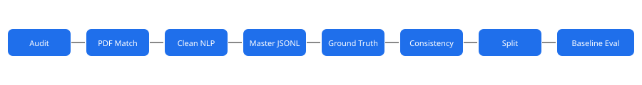

# LiverSira-AI

> NLP data pipeline for the HCC Surveillance AI Platform — extracting structured liver-lesion features from radiology reports.

[](https://www.python.org/downloads/)
[](LICENSE)
[](tests/)



## Overview

**LiverSira-AI** is the data-processing backbone of the **HCC Surveillance AI Platform** — a medical decision-support system for monitoring liver cirrhosis patients and predicting hepatocellular carcinoma (HCC) risk.

This repository handles the **NLP data pipeline**: transforming raw radiology reports from the [AbdomenAtlas 3.0 Mini](https://github.com/MrGiovanni/AbdomenAtlas) dataset into structured, machine-learning-ready features. These features feed downstream models for lesion classification, risk scoring, and follow-up prediction.

> **System boundaries:** The platform does **not** independently diagnose cancer, replace confirmatory CT/MRI examinations, or override physician decisions. All AI outputs are advisory.

### Pipeline & Architecture

| Tier | Component | Purpose |
|------|-----------|---------|
| **Schemas** | [`schemas/master_schema.py`](schemas/master_schema.py) | Master Record schema preserving all 37 columns & multi-organ data |
| | [`schemas/ground_truth_schema.py`](schemas/ground_truth_schema.py) | Benchmark target schema with consistency validators & audit status |
| | [`schemas/inference_schema.py`](schemas/inference_schema.py) | Model prediction schema with evidence text spans & ternary logic |
| **Data Ops** | [`src/data_prep/audit_dataset.py`](src/data_prep/audit_dataset.py) | Profile the raw CSV — missing values, duplicates, target consistency |
| | [`src/data_prep/check_pdf_csv_match.py`](src/data_prep/check_pdf_csv_match.py) | Cross-check BDMAP IDs between CSV metadata and 9,262 PDF reports |
| | [`src/data_prep/prepare_nlp_dataset.py`](src/data_prep/prepare_nlp_dataset.py) | Clean report text, produce `liver_nlp_clean.csv` |
| | [`src/data_prep/generate_master_jsonl.py`](src/data_prep/generate_master_jsonl.py) | Generates `master_records.jsonl` (9,262 records, 0 rows dropped) |
| | [`src/data_prep/generate_ground_truth_jsonl.py`](src/data_prep/generate_ground_truth_jsonl.py) | Generates source-derived `ground_truth.jsonl` (pending verification) |
| | [`src/data_prep/audit_target_consistency.py`](src/data_prep/audit_target_consistency.py) | Automated text vs label consistency audit across all 9,262 studies |
| | [`src/nlp_parser.py`](src/nlp_parser.py) | Shared rule-based parsing used by the baseline and consistency audit |
| | [`src/data_prep/validate_targets.py`](src/data_prep/validate_targets.py) | Extracts the 79-case human adjudication sample |
| | [`src/data_prep/adjudicate_validation_sample.py`](src/data_prep/adjudicate_validation_sample.py) | Validates reviewer-entered adjudication and promotes eligible records in `ground_truth.jsonl` |
| | [`src/data_prep/split_dataset.py`](src/data_prep/split_dataset.py) | Stratified 70/15/15 dataset partitioning into Train/Val/Test |
| | [`src/baseline_extractor.py`](src/baseline_extractor.py) | Rule-based NLP baseline extracting liver-lesion targets |
| **Evaluation** | [`evaluation/baseline/evaluate_baseline.py`](evaluation/baseline/evaluate_baseline.py) | Evaluation against Ground Truth across validation and test splits |
| **Learned NLP** | [`experiments/learned_presence/train_learned_presence.py`](experiments/learned_presence/train_learned_presence.py) | Validation-only learned presence experiment |
| | [`experiments/learned_presence/compare_learned_presence.py`](experiments/learned_presence/compare_learned_presence.py) | Validation-only architecture and leakage comparison |
| | [`experiments/learned_presence/final_evaluate_learned_presence.py`](experiments/learned_presence/final_evaluate_learned_presence.py) | Single final Test evaluation of the frozen model |

## Project Structure

```
LiverSira-AI/
├── data/
│   ├── raw/                        # Source data (git-ignored — see data/README.md)
│   │   ├── AbdomenAtlas3.0MiniWithMeta.csv
│   │   └── pdf_reports/            # 9,262 radiology report PDFs
│   └── processed/                  # Pipeline outputs (git-ignored)
│       ├── liver_nlp_clean.csv
│       ├── master_records.jsonl
│       ├── ground_truth.jsonl
│       ├── target_consistency_audit.csv
│       ├── target_validation_review.csv
│       ├── splits.json
│       └── dataset_splits.csv
├── schemas/                        # Pydantic v2 data models
│   ├── __init__.py
│   ├── master_schema.py
│   ├── ground_truth_schema.py
│   └── inference_schema.py
├── src/
│   ├── __init__.py
│   ├── data_prep/                  # Dataset preparation and review workflows
│   │   ├── audit_dataset.py
│   │   ├── check_pdf_csv_match.py
│   │   ├── prepare_nlp_dataset.py
│   │   ├── generate_master_jsonl.py
│   │   ├── generate_ground_truth_jsonl.py
│   │   ├── audit_target_consistency.py
│   │   ├── validate_targets.py
│   │   ├── adjudicate_validation_sample.py
│   │   └── split_dataset.py
│   ├── nlp_parser.py              # Shared baseline/audit text parser
│   ├── baseline_extractor.py       # Rule-based NLP baseline
├── experiments/
│   └── learned_presence/           # Learned validation and final evaluation scripts
│       ├── train_learned_presence.py
│       ├── compare_learned_presence.py
│       └── final_evaluate_learned_presence.py
├── evaluation/
│   ├── baseline/                   # Baseline code, metrics, reports, and both inference generations
│   ├── model_artifacts/            # Initial learned-model artifacts
│   ├── learned_presence_validation/ # Validation predictions, metrics, and report
│   ├── architecture_comparison/   # Validation-only comparison artifacts
│   └── final_test/                 # Frozen final Test artifacts
├── scripts/
│   ├── __init__.py
│   └── run_pipeline.py             # One-shot end-to-end pipeline runner
├── tests/                          # Pytest test suite
│   ├── test_schemas.py
│   ├── test_audit.py
│   └── test_baseline.py
├── pyproject.toml                  # Pytest configuration
├── .gitignore
├── LICENSE
├── README.md
└── requirements.txt
```

## Getting Started

### Prerequisites

- Python 3.12 or later (tested on 3.14; dependencies are pinned in `requirements.txt` / `pyproject.toml`)
- The [AbdomenAtlas 3.0 Mini](https://github.com/MrGiovanni/AbdomenAtlas) dataset (CSV + PDF reports)

### Installation

```bash
# Clone the repository
git clone https://github.com/zeyadwaled25/LiverSira-AI.git
cd LiverSira-AI

# Create and activate a virtual environment
python -m venv .venv
# Windows
.venv\Scripts\activate
# macOS / Linux
source .venv/bin/activate

# Install dependencies
pip install -r requirements.txt
```

### Data Setup

1. Place `AbdomenAtlas3.0MiniWithMeta.csv` in `data/raw/`.
2. Extract PDF reports into `data/raw/pdf_reports/`.
3. See [`data/README.md`](data/README.md) for the expected directory layout.

### Running the Pipeline

Run the steps in order, or execute the whole pipeline at once:

```bash
python -m scripts.run_pipeline
```

Individual steps (equivalent to the one-shot command above):

```bash
# 1. Audit the raw dataset
python -m src.data_prep.audit_dataset

# 2. Verify PDF <-> CSV matching
python -m src.data_prep.check_pdf_csv_match

# 3. Build the clean NLP dataset
python -m src.data_prep.prepare_nlp_dataset

# 4. Generate Master Dataset JSONL (all 9,262 records)
python -m src.data_prep.generate_master_jsonl

# 5. Generate Ground Truth JSONL (pending verification)
python -m src.data_prep.generate_ground_truth_jsonl

# 6. Audit label <-> report consistency
python -m src.data_prep.audit_target_consistency

# 7. Extract human validation review sample (79 cases)
python -m src.data_prep.validate_targets

# 8. A human reviewer must complete every review field, reviewer_id, and
#    reviewed_at in the CSV. The adjudicator reads the CSV without rewriting it
#    and promotes only valid, attributable reviews.
python -m src.data_prep.adjudicate_validation_sample

# 9. Create stratified 70/15/15 splits
python -m src.data_prep.split_dataset

# 10. Run the rule-based NLP baseline.
#     Writes evaluation/baseline/baseline_inferences_updated.jsonl.
#     The historical baseline_inferences.jsonl remains unchanged.
python -m src.baseline_extractor

# 11. Evaluate the updated baseline on validation and test splits
python -m evaluation.baseline.evaluate_baseline

# 12. Run test suite
pytest
```

`scripts.run_pipeline` executes the same data preparation, adjudication,
baseline, and evaluation steps in order. It requires the raw and processed
data described in [`data/README.md`](data/README.md). The adjudication step
reads the existing review cohort without rewriting it and updates only the
ground-truth validation metadata for complete, attributable reviews; it is not
a learned-model training step.

### First learned NLP experiment

The first learned experiment targets binary `has_lesion` prediction using only
`narrative_clean`. It uses word/character TF-IDF features with class-weighted
logistic regression, trains on `train`, and evaluates on `val` only. It does
not use the Test split, structured reports, or ground-truth fields as input.

```bash
python -m experiments.learned_presence.train_learned_presence
```

Artifacts are written under `evaluation/model_artifacts/` and validation outputs
under `evaluation/learned_presence_validation/`. The source-derived labels are provisional comparisons,
not clinical gold-standard labels; the 79 legacy cases are not treated as
human verified.

To compare the limited learned candidates without loading Test:

```bash
python -m experiments.learned_presence.compare_learned_presence
```

Comparison artifacts and the leakage/duplicate audit are written under
`evaluation/architecture_comparison/`.

### Final Test evaluation

After architecture selection is frozen, train on Train + Validation and run
the final Test evaluation once:

```bash
python -m experiments.learned_presence.final_evaluate_learned_presence
```

This writes the frozen model, configuration, Test predictions, metrics, and
report under `evaluation/final_test/`. It does not modify baseline inference
files or any dataset/split.

Learned-model results compare against source-derived labels, not a clinical
gold standard. The legacy 79-case cohort is not treated as Human Verified, and
Patient-level leakage cannot be ruled out because Patient IDs are unavailable.

## Visual Demonstrations

Suggested animations/GIFs to embed for maximum impact (place assets under `docs/media/`):

1. **Pipeline flow (animated SVG)** — `docs/media/pipeline_flow.svg`: Animate the 11-step pipeline (`audit_dataset` → `evaluate_baseline`) with highlighted nodes as data flows. Embed at top of "Pipeline & Architecture".
2. **Report → structured features (GIF)** — `docs/media/extraction_demo.gif`: Screen recording of `baseline_extractor.py` turning a raw radiology report into 4 extracted targets. Embed in "Usage Examples" / baseline section.
3. **Consistency audit heatmap (GIF)** — `docs/media/audit_heatmap.gif`: `audit_target_consistency.py` output heatmap of text-vs-label agreement. Embed in Evaluation section.
4. **Stratified split distribution (animated SVG)** — `docs/media/split_distribution.svg`: Bar chart animating class balance across Train/Val/Test. Embed in Dataset Details.

Embed pattern:
```markdown

```

## Dataset Details

| Property | Value |
|----------|-------|
| Source | [AbdomenAtlas 3.0 Mini](https://github.com/MrGiovanni/AbdomenAtlas) |
| Total Records | 9,262 |
| Positive Liver Lesion Records | 1,470 |
| PDF reports | 9,262 |
| Master JSONL Records | 9,262 |
| Ground Truth JSONL Records | 9,262 |

### Missing-Value Placeholders

The pipeline standardizes missing liver-lesion values with explicit sentinels:

| Placeholder | Meaning |
|-------------|---------|
| `NO_LESION` | Zero lesions — location field does not apply |
| `NOT_APPLICABLE` | Zero lesions — diameter / attenuation do not apply |
| `UNKNOWN` | Lesions present but the value is missing in the source data |

## Part of the HCC Surveillance AI Platform

This NLP pipeline is one component of a larger clinical system:

| Phase | Component | Status |
|-------|-----------|--------|
| MVP-1 | Ultrasound AI (lesion classification) | Mandatory |
| MVP-1 | **NLP data pipeline (this repo)** | Mandatory |
| Phase 2 | Clinical registry & workflow | Conditional |
| Phase 3 | HCC risk prediction, follow-up prediction, patient/coordinator portals | Conditional |

## Contributing

1. Fork the repository.
2. Create a feature branch (`git checkout -b feature/my-feature`).
3. Commit your changes (`git commit -m "Add my feature"`).
4. Push to the branch (`git push origin feature/my-feature`).
5. Open a Pull Request.

## License

This project is licensed under the MIT License — see the [LICENSE](LICENSE) file for details.

## Acknowledgements

- [AbdomenAtlas 3.0](https://github.com/MrGiovanni/AbdomenAtlas) for the radiology dataset.
- Faculty of Computer Science & AI — Menoufia National University.
