<div align="center">



<br>


[](LICENSE)
[](#licence-and-data-notice)

**[Overview](#overview)** ·
**[How it works](#how-it-works)** ·
**[Status](#status)** ·
**[Key results](#key-results)** ·
**[Setup](#setup)** ·
**[NLP](#nlp-workflows)** ·
**[CV](#cv-workflows)** ·
**[Results](#results)** ·
**[Licence](#licence-and-data-notice)**

</div>

---

## Overview

LiverSira AI is a graduation project with two separate pipelines:

| | Pipeline | Input | Output |
|---|---|---|---|
| 🧾 | **NLP** | Radiology reports from AbdomenAtlas 3.0 Mini (CSV + PDF) | Structured liver-lesion features: presence, count, Couinaud segments, largest diameter, attenuation, each backed by an evidence span in the report |
| 🩻 | **CV** | SMC-LUD liver ultrasound images | A patient-level split, native-aspect preprocessing and a ResNet18 baseline notebook for HCC vs Hemangioma |

The NLP side compares a rule-based parser (v1.0 → v1.1 → v1.2), a classical
learned presence model (TF-IDF + logistic regression), transformer models
(BERT, BioBERT, ClinicalBERT) for presence and for field extraction, a hybrid
of parser and model, and API LLMs as references. Every candidate is frozen and
hashed before its single final evaluation.

> [!IMPORTANT]
> Every score in this repository is measured against **source-derived
> labels** or labels set by construction, not a clinical gold standard.
> Nothing here is clinical validation, and nothing here justifies autonomous
> clinical use.

## How it works

### From report text to structured features

<p align="center">
  
</p>

1. **Liver-only text** (`liversira_ai.nlp.liver_text`, v1.0.1) cuts the report
   into sections, units and clauses and keeps only the clauses about the
   liver, with offsets back into the source text.
2. **Extraction** reads that text. Parser v1.2 is deterministic and returns an
   evidence span for every value; the ClinicalBERT extractor (C3) predicts
   count, segments, attenuation and diameter; hybrid **H** takes the parser's
   value and falls back to the model only when the parser leaves a field
   empty (`liversira_ai.nlp.hybrid.hybrid_h`).
3. **Output** follows the Pydantic schemas in `liversira_ai.nlp.schemas`:
   ternary presence (true / false / unknown), the largest-lesion fields, and
   evidence spans with character offsets.

The report in the animation is synthetic; it is not taken from the dataset.

### Pipelines

<p align="center">
  
</p>

| Id | Frozen candidate | Code |
|---|---|---|
| C1 | Parser v1.1 | `liversira_ai.nlp.parser_v1_1` |
| C2 | Parser v1.2 (14 rules, each justified by a Train-aug item) | `liversira_ai.nlp.parser_v1_2`, `parser_v1_2_rules` |
| C3 | First extraction model (ClinicalBERT, seeds 13 / 42 / 87) | `liversira_ai.nlp.extraction_model` |
| C5 | Hybrid H = C2, with C3 filling empty fields | `liversira_ai.nlp.hybrid` |
| P1 | Presence: frozen TF-IDF + LR (default) | `liversira_ai.nlp.learned_presence` |
| P2 | Presence: ClinicalBERT, seeds 13 / 42 / 87 | `liversira_ai.nlp.transformer_models` |
| R1, R2 | Phase 7 API LLMs (Nemotron 3.5 Lightning, Gemini 3.5 Flash-Lite): **references only**, not deployable, not run in Phase 8 | `liversira_ai.nlp.llm_extraction` |

C4 (per-lesion model) and C6 (hybrid H2) were retired by Amendment 3 of the
[Phase 8 analysis plan](docs/nlp/phase8_analysis_plan.md); their results stay
in the repository.

## Status


Implemented and backed by committed results:

- ✅ NLP data preparation, audit, frozen study-level splits.
- ✅ Rule-based parser v1.0 and v1.1, with Validation and single-use Test
  evaluations.
- ✅ Learned presence model (TF-IDF + logistic regression), with Validation and
  single-use Test evaluations and a reliability report.
- ✅ Transformer presence experiments (BERT, BioBERT, ClinicalBERT) on
  Validation and a Challenge Set. They have not been evaluated on Test.
- ✅ Liver-only text filter (v1.0.1) and its retention and leakage checks.
- ✅ Phase 6.2 extraction: Train-aug data, ClinicalBERT extraction models,
  parser v1.2 tuned on Train-aug only, hybrid H, Validation re-scored on
  verifiable fields only, and Challenge-A diagnostics
  ([status](docs/nlp/phase6_2_status.md)).
- ✅ Phase 7 LLM extraction with a frozen prompt, as a reference
  ([report](docs/nlp/phase7_report.md)).
- ✅ Phase 8 candidates and analysis plan frozen and hashed
  (`results/nlp/phase8/candidates_freeze.json`).
- ✅ CV patient-level split materialization and two preprocessing
  implementations.

Waiting, not implemented, or without recorded results:

- ⏳ **Challenge-B**, the held-out extraction test, is waiting for its author
  (brief and validator are ready: `docs/nlp/challenge_b_brief.md`).
- ⏳ The human gold standard for NLP is supported by scripts, but
  `gold_standard.jsonl` is produced only once annotators complete it.
- ⏳ The **Phase 8** final evaluation has not run. Extraction has not been
  evaluated on Test.
- ❌ The canonical native-aspect CV pipeline has **no recorded results yet** (see
  [CV preprocessing](#cv-preprocessing)).
- ❌ There is no CV evaluation pipeline and no CV evaluation on Test.
- ❌ There is no API, service or user interface in this repository.

## Key results

All numbers are against source-derived labels; 95% intervals in brackets.

**Single-use Test runs (1390 studies, run once, never re-run):**

| System | Metric | Test |
|---|---|---|
| Parser v1.1 | Presence selective F1 (on answered studies) | 1.000 [1.000, 1.000] |
| Parser v1.1 | Presence coverage | 0.445 [0.419, 0.471] |
| Parser v1.1 | Diameter within 0.5 cm (where predicted) | 0.991 [0.977, 1.000] |
| Parser v1.1 | Count exact (where predicted) | 0.980 [0.960, 0.995] |
| Frozen TF-IDF + LR | Presence F1 (coverage 1.000) | 0.998 |
| Frozen TF-IDF + LR | Presence specificity | 1.000 |

Sources: [`parser_v1_1/test_evaluation.md`](results/nlp/parser_v1_1/test_evaluation.md),
[`final_test/learned_presence_test_report.md`](results/nlp/final_test/learned_presence_test_report.md).

**Extraction on Validation (220 lesion-positive reports, verifiable fields only, development data):**

| System | count | segments | attenuation | diameter |
|---|---|---|---|---|
| C2 parser v1.2 | 1.000 | 0.990 | 0.977 | 1.000 |
| C3 ClinicalBERT extractor | 1.000 | 0.974 | 1.000 | 1.000 |
| C5 hybrid H | 1.000 | 0.995 | 0.986 | 1.000 |

Source: [`phase8/validation_rescored.md`](results/nlp/phase8/validation_rescored.md).
Which system extracts each field is decided only by the single Phase 8 run.

## Structure

```text
LiverSira AI/
├── src/liversira_ai/          # reusable package (installed in editable mode)
│   ├── common/                # paths, hashing and Git provenance helpers
│   ├── cv/data/               # split materialization, preprocessing, letterbox
│   └── nlp/                   # parsers, liver-only text, models, hybrid, LLM client, metrics
│       ├── data/              # raw CSV, audit, gold set, adjudication
│       └── schemas/           # Pydantic schemas (master, ground truth, inference, gold standard)
├── scripts/                   # complete workflows, run from the repository root
│   ├── cv/
│   └── nlp/                   # data preparation, parser and baseline evaluation
│       ├── learned_presence/  # classical presence model experiments
│       ├── llm/               # Phase 7 API LLM extraction
│       └── transformers/
│           ├── presence/      # BERT / BioBERT / ClinicalBERT presence
│           └── extraction/    # 6.2 extraction, parser v1.2, Phase 8 freeze, Challenge-B
├── notebooks/                 # exploration and visual inspection
│   ├── cv/
│   └── nlp/
├── tests/                     # pytest suite
├── results/                   # committed metrics, reports and predictions
├── docs/
│   ├── cv/                    # legacy letterbox configuration record
│   ├── media/                 # README animations (SVG)
│   └── nlp/                   # annotation guidelines, phase plans and reports
├── data/                      # datasets (gitignored; see data/README.md)
└── models/                    # model weights (gitignored)
```

Responsibilities:

- `.py` files in `src/` hold reusable code: preprocessing, parsing, metrics,
  schemas and shared helpers.
- `scripts/` holds entry points that run a complete workflow and import from
  `src/`.
- `.ipynb` notebooks are for exploration, visual checks and experiments; they
  import from `src/` and show their output inline.

## Setup

Create `.venv`, then install the project in editable mode together with the
development tools. Dependencies are declared once, in `pyproject.toml`;
`requirements.txt` only points at it.

```powershell
python -m venv .venv
.venv\Scripts\python.exe -m pip install -e ".[dev]"
Copy-Item .env.example .env
```

For the Phase 7 LLM scripts, also install the `llm` extra
(`pip install -e ".[dev,llm]"`). API keys are read from the environment
variables named in `scripts/nlp/llm/config.json` and are never stored.

The editable install makes `liversira_ai` importable everywhere, so no
`PYTHONPATH` is needed. Scripts use paths relative to the repository root, so
run them from there.

<details>
<summary><b>Bytecode</b></summary>

The project runs with `PYTHONDONTWRITEBYTECODE=1`, so Python writes no
`__pycache__/` directories or `.pyc` files:

- `.env` (copied from `.env.example`, gitignored) holds the variable.
- VS Code: `.vscode/settings.json` sets `python.envFile` to that `.env` and
  enables `python.terminal.useEnvFile`, so the Python extension applies it to
  new terminals, test runs, debugging and Jupyter kernels. Reload the window
  after creating `.env`.
- Any other shell: set it once per session before running Python.

  ```powershell
  $env:PYTHONDONTWRITEBYTECODE = "1"
  ```

- Notebooks set `sys.dont_write_bytecode = True` in their first cell, which
  also covers Colab.

`__pycache__/` and `*.pyc` stay in `.gitignore` as a backstop.

</details>

<details>
<summary><b>GPU</b></summary>

The editable install on Windows resolves to the CPU-only PyTorch build. To
train on an NVIDIA GPU, replace it with the CUDA build of the same pinned
versions (CUDA 13.2 wheels; the NVIDIA driver must support CUDA 13.2 or
newer):

```powershell
.venv\Scripts\python.exe -m pip install --force-reinstall --no-deps torch==2.15.0 torchvision==0.29.2 --index-url https://download.pytorch.org/whl/cu132
.venv\Scripts\python.exe -c "import torch; print(torch.__version__, torch.cuda.is_available(), torch.cuda.get_device_name(0))"
```

The check should print `2.15.0+cu132`, `True`, and the GPU name.

</details>

<details>
<summary><b>Colab</b></summary>

The notebooks also run on Colab from
`/content/drive/MyDrive/LiverSira AI/Training/`, which must contain `data/`,
`src/` and `notebooks/`. The package is not installed there; each notebook
adds `Training/src` to the import path. The notebooks import their
preprocessing from `src/`, so **upload the current `src/` folder to Drive
whenever it changes**; an outdated copy fails on import or silently runs old
code.

</details>

## Data

Datasets are not in Git. Place the AbdomenAtlas CSV and PDF reports under
`data/raw/nlp/` and the original SMC-LUD dataset under
`data/raw/cv/SMC-LUD/`. [data/README.md](data/README.md) describes the
expected layout, what is and is not tracked, and how each generated file is
produced.

## NLP workflows

Prepare the dataset and the frozen study-level splits:

```powershell
python scripts/nlp/prepare_dataset.py
```

Reliability report (bootstrap 95% CIs, coverage-adjusted presence metrics,
paired learned-vs-rule-based comparison) from saved predictions:

```powershell
python scripts/nlp/reliability_report.py
```

Human gold set (two blinded annotators, agreement, clinician adjudication);
see `docs/nlp/gold_set_annotation_guidelines.md`:

```powershell
python scripts/nlp/gold_set.py sample    # then annotators fill sheets A and B
python scripts/nlp/gold_set.py agree     # then a clinician resolves disagreements
python scripts/nlp/gold_set.py finalize
python scripts/nlp/gold_set.py apply     # writes data/processed/nlp/gold_standard.jsonl
```

Once `gold_standard.jsonl` exists, the reliability report also scores both
systems against it.

### Rule-based parser

`liversira_ai.nlp.parser_v1_1` is v1.1 (organ-scoped clauses, largest-lesion
selection, no count imputation, value-level evidence spans);
`liversira_ai.nlp.parser_v1_0` is the frozen v1.0 used by the audit and kept
for reproducibility. Golden cases are in
`tests/fixtures/parser_v1_1_golden.json`. Validation-only comparison of the
two versions:

```powershell
python scripts/nlp/validate_parser.py
```

`scripts/nlp/evaluate_parser_test.py` is the single-use Test evaluation of
parser v1.1. It has already been run and refuses to run again.

`liversira_ai.nlp.parser_v1_2` (rules in `parser_v1_2_rules.py`) adds 14 rules
tuned on Train-aug only, each tied to the Train-aug item that justifies it and
checked by ablation; presence logic is unchanged from v1.1:

```powershell
python -m scripts.nlp.transformers.extraction.parser_v1_2_report
```

The rule-based baseline scripts (`evaluate_baseline.py`, `error_analysis.py`,
`create_benchmark_manifest.py`) are also in `scripts/nlp/`.

### Learned presence

The classical presence experiments are in `scripts/nlp/learned_presence/`.
These scripts import each other, so run them as modules from the repository
root, not as files:

```powershell
python -m scripts.nlp.learned_presence.train_learned_presence
python -m scripts.nlp.learned_presence.compare_learned_presence
python -m scripts.nlp.learned_presence.export_frozen_model
python -m scripts.nlp.learned_presence.regenerate_audit_groups --check   # read-only comparison with results/
```

`final_evaluate_learned_presence` is the single-use Test evaluation of the
frozen model. It has already been run; do not run it again. An untracked
local copy of its predictions,
`results/nlp/final_test/learned_presence_test_predictions.jsonl`, is dated
10 November 2026; its predictions are identical to the tracked
`results/nlp/predictions/learned_presence_test_predictions.jsonl`.

The frozen model `results/nlp/final_test/learned_presence_word_logreg_final.joblib`
is gitignored. Verify any copy against its SHA-256 before use (also recorded
in `learned_presence_word_logreg_final_model_manifest.json` next to it):

```text
333d4e2aed0c93e3add9934e662b4461ae0db6bf6c8de49eb04f3a61f49ea19a
```

### Transformers

Transformer experiments are in `scripts/nlp/transformers/`. Models are pinned
in `liversira_ai.nlp.transformer_models`; Test is never read. Presence uses
one shared `presence/config.json` for BERT, BioBERT and ClinicalBERT:

```powershell
.venv\Scripts\python.exe scripts/nlp/transformers/token_lengths.py                  # truncation policy
.venv\Scripts\python.exe scripts/nlp/transformers/presence/build_challenge_set.py   # from Validation only
.venv\Scripts\python.exe scripts/nlp/transformers/presence/train.py --model bert --seed 42
.venv\Scripts\python.exe scripts/nlp/transformers/presence/run_all.py               # all models x seeds, resumable
.venv\Scripts\python.exe scripts/nlp/transformers/presence/compare_models.py        # vs LR and parser v1.1
```

Weights go to `models/transformers/` (gitignored, safetensors, hashed in the
run manifest); predictions and metrics go to `results/nlp/transformers/`.

### Liver-only text

`liversira_ai.nlp.liver_text` keeps only the liver-related clauses of a
report, with offsets into the source. Every extraction candidate reads this
text. Write the liver-only copy of the cleaned CSV and check what the filter
keeps (Train and Validation only):

```powershell
python scripts/nlp/build_liver_only_dataset.py
```

### Extraction (Phase 6.2)

The extraction scripts in `scripts/nlp/transformers/extraction/` import each
other, so run them as modules. Training data is built from Train reports plus
generated items whose targets are known by construction; Test is not read:

```powershell
python -m scripts.nlp.transformers.extraction.build_training_set
python -m scripts.nlp.transformers.extraction.train --model clinicalbert --seed 42
python -m scripts.nlp.transformers.extraction.run_all                 # every model x seed, resumable
python -m scripts.nlp.transformers.extraction.compare                 # vs parser, criteria in config.json
python -m scripts.nlp.transformers.extraction.rescore_validation      # verifiable fields only (Amendment 3)
```

### Phase 7: API LLMs (references)

Two API models run once with a frozen prompt on a fixed subsample. They are
references, not deployable candidates:

```powershell
python -m scripts.nlp.llm.smoke_test                                   # one synthetic call per provider
python -m scripts.nlp.llm.run_llm_extraction --provider nvidia --set validation
python -m scripts.nlp.llm.phase7_report                                # no API calls
```

See [`docs/nlp/phase7_llm_plan.md`](docs/nlp/phase7_llm_plan.md) and
[`docs/nlp/phase7_report.md`](docs/nlp/phase7_report.md).

### Phase 8: freeze and Challenge-B

The candidates, the analysis plan and the scoring code are hashed in
`results/nlp/phase8/candidates_freeze.json`. Check that nothing has changed
(`tests/test_phase8_freeze.py` does the same):

```powershell
python -m scripts.nlp.transformers.extraction.freeze_candidates --check
```

Challenge-B is written by one team member from
[`docs/nlp/challenge_b_brief.md`](docs/nlp/challenge_b_brief.md) and frozen
with `validate_challenge_b` (stages `items`, `coverage`, `check`). Its author
must not read the parser code, the Train-aug data or the Challenge Sets
first; the brief lists exactly what to avoid.

## CV workflows

Materialize the physical patient-level split from the manifest:

```powershell
python scripts/cv/materialize_cv_split.py
```

The manifest `data/manifests/cv/SMC-LUD/patient_level_manifest.csv` is the
source of truth for the split. The original images are never moved or
modified. The materializer is idempotent: existing files are accepted only
when their checksums match the manifest, and conflicting files fail instead
of being silently overwritten.

### CV preprocessing

Two preprocessing implementations are kept, under distinct names:

- `src/liversira_ai/cv/data/preprocessing.py` is the canonical one: native
  aspect ratio, shorter side resized to 224, a conservative trim of solid
  near-black edge strips, no padding, no crop, no stretching
  (`preprocess_image`, `NativeAspectUltrasoundDataset`). Notebooks 04 and 05
  import it. **It has no recorded results yet**: no run of it has saved
  metrics, cell outputs or a checkpoint in this repository.
- `src/liversira_ai/cv/data/letterbox.py` is the earlier square letterbox
  pipeline (`preprocess_image_letterbox`, `SMCLUDDataset`), kept for
  reference. Its settings are recorded in
  `docs/cv/legacy_letterbox_preprocessing_config.yaml`, which no code reads.

What the existing CV numbers do and do not show:

- The only ResNet18 numbers on record (the "Historical Letterbox baseline"
  table in notebook 05) come from the letterbox pipeline. That pipeline has a
  documented label shortcut: it added about 19.8% black padding to Hemangioma
  images and none to HCC images, because every HCC image is square and no
  Hemangioma image is. Those numbers are therefore not evidence that the
  model learned lesion appearance.
- That baseline table and the shortcut-audit table in notebook 04 were
  entered by hand. The runs and code that produced them are not in this
  repository, so they cannot be reproduced from it.
- `results/cv/preprocessing_report.md` describes the letterbox pipeline and
  was written by a script that has since been removed.
- No model has been trained or evaluated on the CV Test split. Test images
  were decoded and checksummed for inspection only, by an earlier committed
  version of notebook 04 and by the removed report script. The current
  notebooks 04 and 05 read Train and Validation only.

## Notebooks

Notebooks display tables, figures and metrics inline and write no reports or
figures. Notebook 05 is the one exception: it saves its best checkpoint.

| Notebook | What it shows |
|---|---|
| `notebooks/cv/04_image_preprocessing.ipynb` | Native-aspect preprocessing: Train/Validation split checks, comparison with the old letterbox, and tensor checks |
| `notebooks/cv/05_baseline_training.ipynb` | ResNet18 baseline on the native-aspect input (frozen backbone, patient-weighted loss, image-level and patient-level Validation metrics). The training loop and model builder are defined in the notebook; it saves the best checkpoint under `models/cv/` (gitignored). The Test split is not read |
| `notebooks/nlp/01_dataset_audit_and_cleaning.ipynb` | Raw AbdomenAtlas inspection and text-cleaning checks |
| `notebooks/nlp/02_rule_based_parser_and_inference.ipynb` | Parser evidence, uncertainty, and structured baseline inference inspection |
| `notebooks/nlp/03_evaluation_and_error_analysis.ipynb` | Existing baseline and learned-presence metrics, split integrity, and inline error inspection |

## Tests

All tests are in `tests/` (parsers and golden cases, liver-only text,
schemas, metrics, models, hybrid, LLM client, Phase 8 freeze, CV
preprocessing):

```powershell
pytest
```

## Results

`results/` holds the metrics, reports, predictions and manifests of the
experiments above. They are kept exactly as produced.
[`results/nlp/README.md`](results/nlp/README.md) says what each NLP folder
holds and which report to read first. Known limitations:

- Scripts were reorganised after the results were produced, so some result
  files name old script paths (see [Old script paths](#old-script-paths)).
- `results/cv/preprocessing_contact_sheet.png` shows SMC-LUD ultrasound
  frames, so it is gitignored and not distributed. It was written by a script
  that has since been removed, so it cannot be regenerated from the current
  code. `results/cv/preprocessing_report.md` links to it.
- SHA-256 values recorded in result manifests were computed on a Windows
  checkout, where Git stores text files with LF line endings but writes them
  to disk with CRLF. On a checkout with LF line endings (Linux, macOS, or
  `core.autocrlf=false`) the same files hash differently, so verify recorded
  hashes on Windows or after converting line endings.

### Old script paths

<details>
<summary>Mapping from old to current paths</summary>

| Old path | Current path |
|---|---|
| `evaluation/baseline/*.py` | `scripts/nlp/*.py` |
| `evaluation/learned_presence/*.py` | `scripts/nlp/learned_presence/*.py` |
| `evaluation/learned_presence/utils.py` | `src/liversira_ai/nlp/learned_presence.py` |
| `evaluation/regenerate_audit_groups.py` | `scripts/nlp/learned_presence/regenerate_audit_groups.py` |
| `evaluation/tests/` | `tests/` |
| `experiments/transformers/token_lengths.py` | `scripts/nlp/transformers/token_lengths.py` |
| `experiments/transformers/presence/*` | `scripts/nlp/transformers/presence/*` |
| `experiments/transformers/data.py` | `src/liversira_ai/nlp/transformer_data.py` |
| `experiments/transformers/models.py` | `src/liversira_ai/nlp/transformer_models.py` |
| `configs/cv/preprocessing_config.yaml` | `docs/cv/legacy_letterbox_preprocessing_config.yaml` |
| `src/liversira_ai/cv/data/preprocessing.py` (letterbox) | `src/liversira_ai/cv/data/letterbox.py` |

</details>

## Licence and data notice

The source code in this repository is released under the MIT License (see
`LICENSE`).

The MIT License does not cover data. Some files under `results/nlp/`,
`tests/fixtures/` and the saved outputs of `notebooks/nlp/` contain text
excerpts and study identifiers (`BDMAP_…`) from the radiology reports of
AbdomenAtlas 3.0 (Bassi et al., "RadGPT: Constructing 3D Image-Text Tumor
Datasets", ICCV 2025), distributed as AbdomenAtlas 3.0 Mini under the Creative
Commons Attribution-NonCommercial-ShareAlike 4.0 International licence
(CC BY-NC-SA 4.0). Those excerpts, and any file that reproduces them, remain
under CC BY-NC-SA 4.0: they may be shared and adapted for non-commercial
purposes only, with attribution to the AbdomenAtlas authors, and under the
same licence. Complete reports are not distributed, but result files contain
many verbatim excerpts of the liver-related sentences.

This repository does not include the SMC-LUD dataset, and no ultrasound
images are tracked in the current tree. Older commits in the public history
still contain some (a preprocessing contact sheet and image outputs saved in
an earlier version of notebook 04); the history has not been rewritten.
Obtain the dataset from its Figshare record and follow its terms.

The animations in `docs/media/` are drawings; they contain no dataset text or
images.
