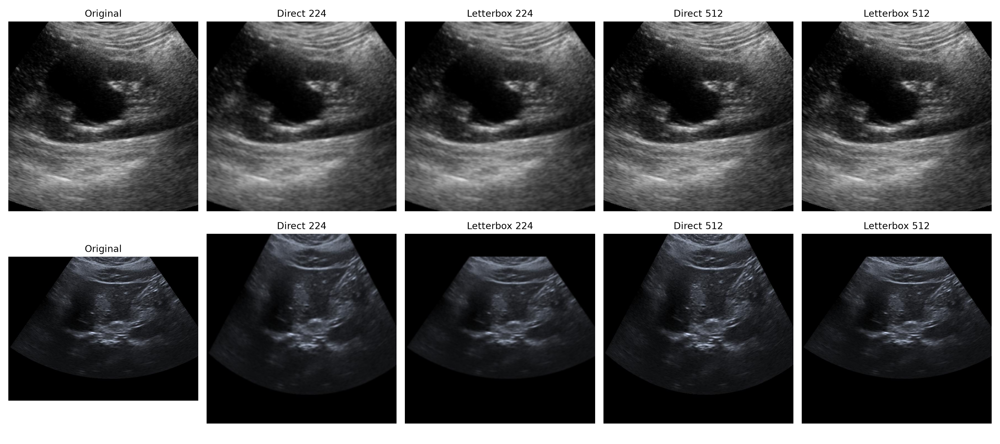

# Phase 9: Image Preprocessing Pipeline

## Configuration

- Dataset root: `data/processed/cv/SMC-LUD/patient_split_v1`
- Image size: **224 x 224**
- Resizing: **letterbox**, bilinear interpolation, black padding; no crop
- Tensor layout: **[3, H, W]**, float32, initial range **[0, 1]**
- Normalization: **ImageNet mean/std** (`[0.485, 0.456, 0.406]` / `[0.229, 0.224, 0.225]`)
- Augmentation: **none**
- Dataset-specific statistics: not used, so no statistics JSON is produced

## Validation

- Accessible image files: **2656/2656**
- Materialized/source MD5 matches: **2656/2656**
- Counts: train HCC 930, train Hemangioma 840; validation HCC 332, validation Hemangioma 297; test HCC 127, test Hemangioma 130
- Source images are read-only; the pipeline writes no preprocessed image copies.
- Labels and `patient_group_id` are read from `patient_split_metadata.csv`.
- Split mixing is prevented by selecting records with the requested split only.
- Direct resize and letterbox are deterministic and do not center-crop.

## Visual comparison

The contact sheet compares the original, direct resize, and letterbox at 224 x 224 and 512 x 512 for one HCC and one Hemangioma training sample. Direct resize changes aspect ratio when source geometry is non-square. Letterbox preserves geometry and adds padding; neither method crops ultrasound structures.

## Remaining decisions before Phase 10

- Select the model input size (224 or 512) per experiment.
- Confirm whether ImageNet normalization remains the fixed baseline; dataset-specific statistics can be computed from train only with `compute_train_stats`.
- Define augmentation policy in Phase 10; none is applied here.
